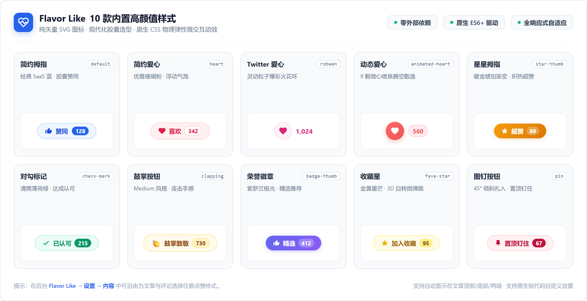

# Flavor Like

[](https://wordpress.org/)
[](https://php.net/)
[](LICENSE)
[]()

WordPress 轻量高颜值点赞插件。原生 JS 驱动零依赖，内置 10 款现代化胶囊样式、Bilibili 风格微动效、数据统计看板与并发安全防护。

---

## 🎨 样式预览



---

## ✨ 核心特性

- **10 款矢量胶囊模板**：简约拇指、红心、火花环、徽章、收藏星等纯 SVG 模板，全自适应不失真。
- **灵动微交互动效**：Bilibili 风格弹性微回弹、火花环冲击波与向上浮动的 `+1` 气泡。
- **互动数据看板**：提供 30 天互动趋势图、热门内容 Top 榜及智能最佳发布时段建议。
- **灵活展示控制**：严格正交控制“启用的文章类型”与“显示按钮位置”，精准控制何时何处显示。
- **轻量与高并发保护**：原生 ES6+ 零依赖，支持按需加载；集成 MySQL 悲观锁，杜绝并发刷票。
- **系统诊断与备份**：内置环境健康检查、一键刷新统计缓存、数据表修复与配置 JSON 导入导出。

---

## 📋 系统要求

- **WordPress**：6.0+
- **PHP**：7.4+（兼容 PHP 8.0 - 8.3）
- **数据库**：MySQL 5.7+ / MariaDB 10.3+

---

## 🚀 快速安装

1. 下载插件包 `flavor-like.zip`。
2. 进入 WordPress 后台 → **插件** → **安装插件** → **上传插件**。
3. 启用插件，在后台 **Flavor Like** 中即可配置与使用。

---

## 🎨 模板样式

可在后台 **Flavor Like → 设置 → 内容** 中为文章和评论自由选择：

| 模板名称 | Slug | 风格特色 |
| :--- | :--- | :--- |
| **简约拇指** | `flavorlike-default` | 经典 SaaS 蓝胶囊，独立计数值 |
| **简约爱心** | `flavorlike-heart` | 柔粉珊瑚心形，呼吸光圈 |
| **Twitter 爱心** | `flavorlike-robeen` | 灵动粒子火花环，扩散冲击波 |
| **动态爱心** | `flavorlike-animated-heart` | 9 颗微心螺旋上升散逸动效 |
| **星星拇指** | `flavorlike-star-thumb` | 暖金琥珀渐变，高亮计数值 |
| **对勾标记** | `flavorlike-check-mark` | 清爽薄荷绿胶囊，达成认可感 |
| **鼓掌按钮** | `flavorlike-clapping` | Medium 连击手感，拍手倾角反馈 |
| **荣誉徽章** | `flavorlike-badge-thumb` | 紫罗兰极光渐变，毛玻璃徽章 |
| **收藏星** | `flavorlike-fave-star` | 3D 自旋转微弹跳，金色充盈 |
| **置顶图钉** | `flavorlike-pin` | 玫瑰红胶囊，45° 倾斜扎入钉住动效 |

---

## 💻 调用方法

### 短代码

```text
[flavor_like]                                   # 在当前文章/页面输出点赞按钮
[flavor_like for="post" id="123"]               # 指定文章 ID
[flavor_like for="comment" id="456"]            # 评论点赞按钮
[flavor_like_counter type="post" status="like"] # 仅输出点赞数值
[flavor_like_likers_box type="post" counter="6"]# 输出点赞者头像列表框
```

### PHP 模板标签

```php
// 输出点赞按钮
if ( function_exists( 'flavor_like' ) ) {
    flavor_like( 'for=post' );
}

// 获取文章点赞总数
if ( function_exists( 'flavor_like_get_post_likes' ) ) {
    echo '点赞数：' . esc_html( flavor_like_get_post_likes( get_the_ID() ) );
}
```

---

## ⚙️ 后台管理

- **统计看板 (`Flavor Like → 统计`)**：核心指标卡（今日/昨日/本周/总计）、30 天趋势折线图、热门内容 Top 8、最佳发布时段。
- **系统设置 (`Flavor Like → 设置`)**：
  - **内容**：模板样式、启用的文章类型、显示位置、在摘要中显示、按钮文案。
  - **基础**：防刷间隔、仅限登录用户、提示文案、点赞者头像。
  - **资源与备份**：全站/按需加载、运行诊断、一键缓存清理、数据表修复、配置导入导出。

---

## 📝 更新日志

### 1.1.0
- **样式与动效**：重构 10 款现代矢量胶囊按钮体系，加入 Bilibili 风格微交互动效。
- **架构精简**：精简为“统计”与“设置”两级清晰架构，全后台采用 SaaS 蓝设计。
- **逻辑重构**：理顺文章类型与展示位置的二维独立控制，解决单页无端显示问题。
- **体验加固**：全面消灭中文乱码，修复侧边菜单滚动穿透与子菜单悬停闪烁问题。
- **质量保障**：内置 19 套自动化测试套件（270 项测试 100% 通过）。

---

## 📄 开源许可证

本项目基于 [GPL-2.0+](LICENSE) 协议开源。
